||||
|-|-|-|
|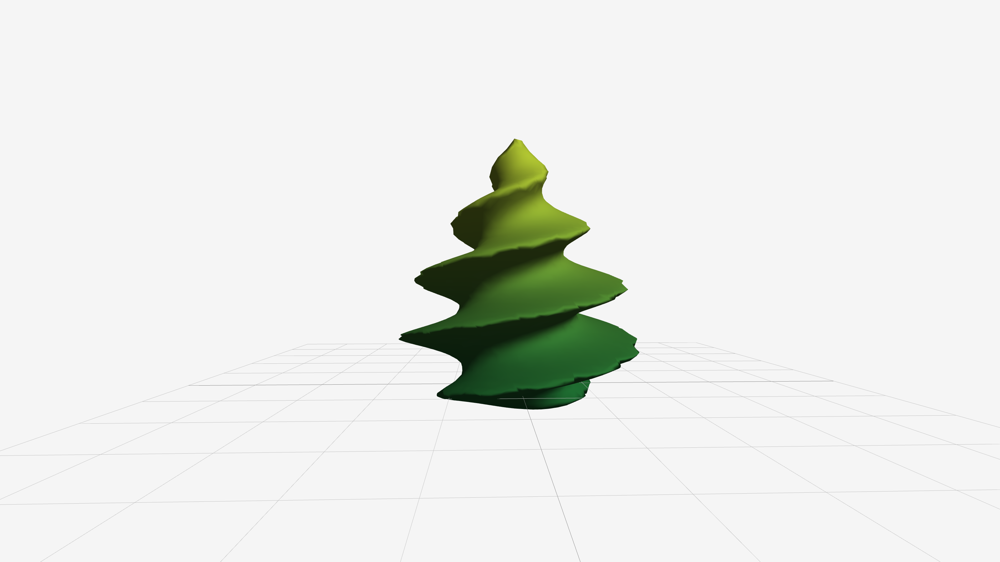|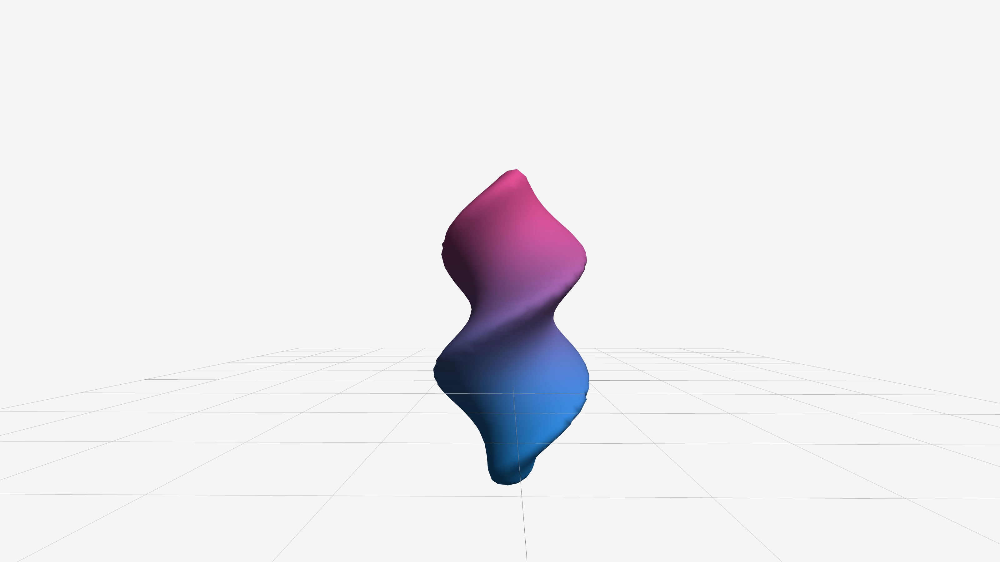|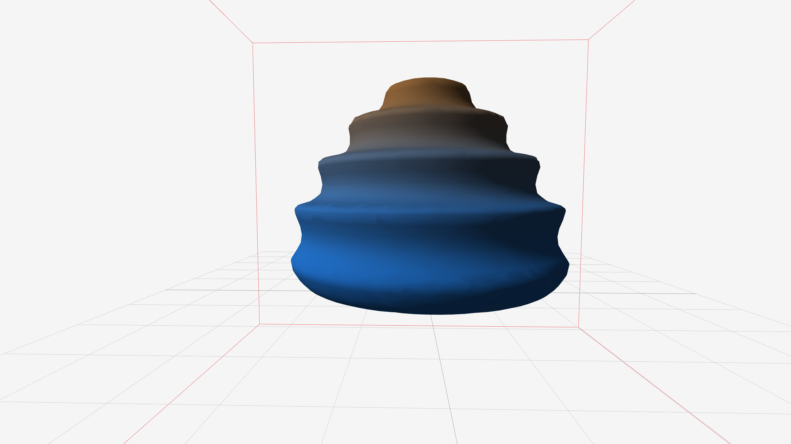|

Léandre Lorenzo - M2 ID3D 2026

Modélisation Géométrique - Rapport de TP
___

# Quelques mots sur l'utilisation de l'IA générative
Pour m'assister dans ce TP, j'ai utilisé le modèle de langage Claude dans trois buts : 
- Développer les outils de visualisations (le projet Qt ne pouvant pas fonctionner sur mon ordinateur à cause de problème de compatibilité OpenGL 3.4).
- Affiner des fonctions et algorithmes que j'ai écris en me guidant pas à pas vers une meilleure solution.
- Être un expert C++ à ma disposition (régler des erreurs de linker ou encore de pointeurs, car le langage C++ ne m'est pas très familier).

## À propos de l'outil de visualisation
J'ai choisi d'utiliser la bibliothèque [raylib](https://www.raylib.com) pour *render* le mesh calculé par `AnalyticalScalarField::Polygonize()`. La biblothèque est notamment fourni avec un [exemple d'affichage et de génération de mesh personnalisés](https://www.raylib.com/examples/models/loader.html?name=models_mesh_generation), avec caméra libre. C'est la base que j'ai utilisé. 

L'outil que j'ai ordonné à Claude de réaliser a les fonctionnalités suivantes :
- Transcrire le Mesh de TinyMesh en Mesh de raylib
- Appliquer un shader qui éclaire la scène
- Afficher un editeur d'arbre textuel
- Parser un arbre textuel
- Insérer des noeuds l'arbre textuel avec des boutons
- Afficher la bounding box de la racine
- Sauvegarder un arbre textuel en .txt
- Charger un fichier d'arbre textuel
- Activer/Désactiver l'accélération par BVH
- Prendre un screenshot du rendu

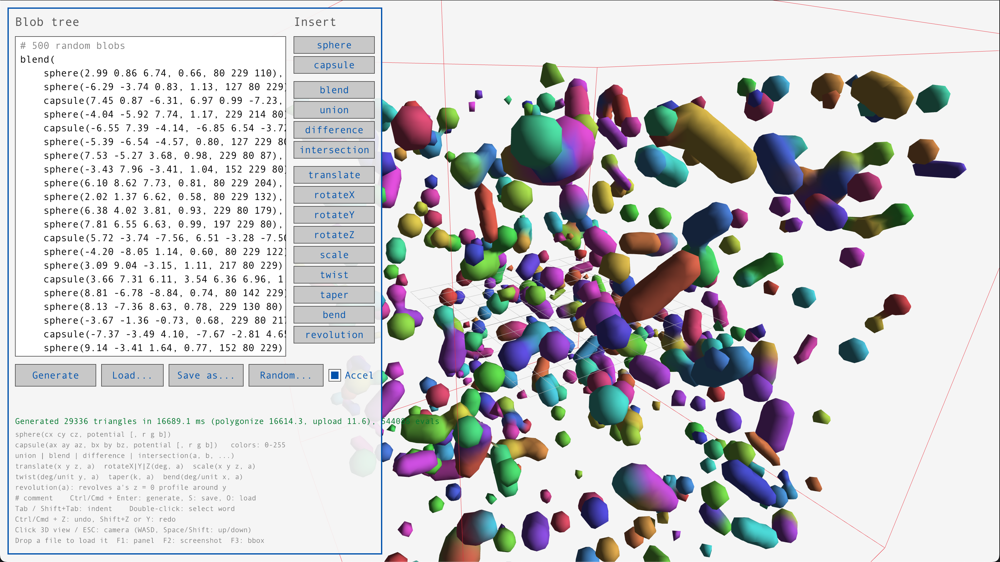
*GUI de l'outil de visualisation*

# Blobs
## Fonctions d'atténuation
Afin de les comparer, deux fonctions d'atténuations ont été implémentées.
### Gaussienne
La gaussienne qui est à support non compact. 

|primitive count|parse|bbox|polygonize|upload|total|triangles|evaluation|
|-|-|-|-|-|-|-|-|
|1|0.010 ms | 0.001 ms | 36.589 ms | 1.640 ms | 38.242 ms | 3212 | 64^3 | 293576 (0.1 us each)|
|10 blend | 0.054 ms | 0.004 ms | 397.015 ms | 11.306 ms | 408.382 ms | 24092, 64^3 grid | 471056 (0.8 us each)|
|100 blend| 0.332 ms | 0.027 ms | 9044.817 ms | 14.081 ms | 9059.258 ms | 30176, 64^3 grid | 537644 (16.8 us each)|

|1 sphere| 10 primitives blended|100 primitves blended|
|-|-|-|
|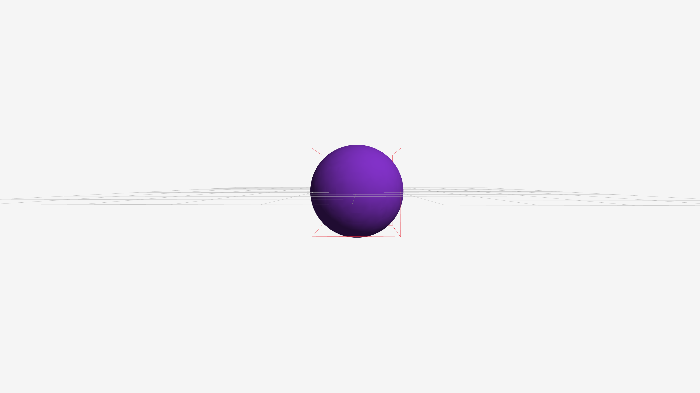|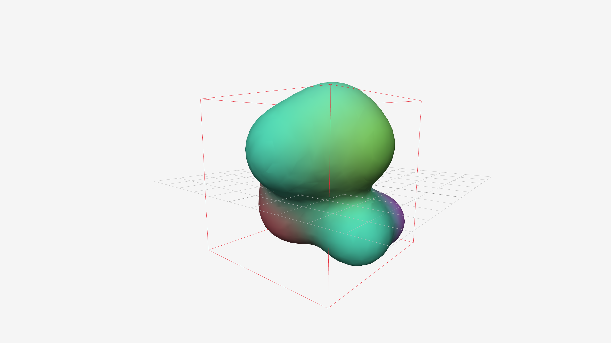 |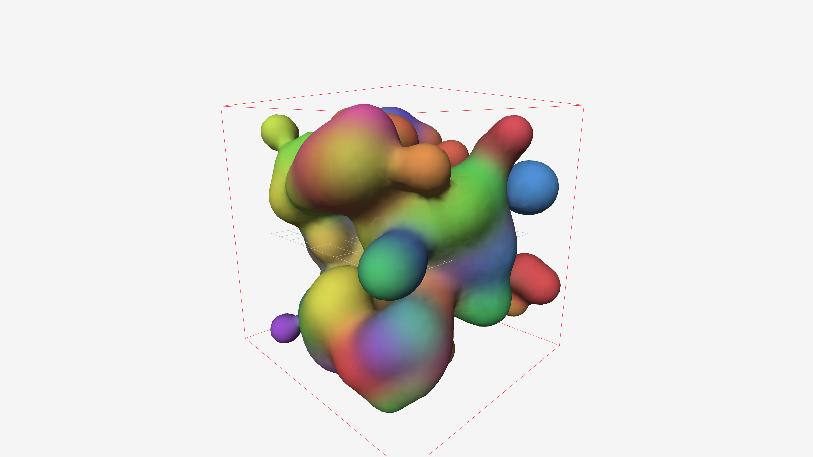|

### Wyvill
Wyvill, à support compact de rayon R (tous les points sont inclus dans la bounding box).

|primitive|parse|bbox|polygonize|upload|total|triangles|grid|evaluation|
|-|-|-|-|-|-|-|-|-|
|1|0.010 ms | 0.001 ms | 46.140 ms | 2.483 ms | 48.636 ms | 7676 | 64^3 | 323840 (0.1 us each)|
|10 blend| 0.056 ms | 0.005 ms | 208.472 ms | 0.642 ms | 209.177 ms | 832, 64^3 grid | 273980 (0.8 us each)
|100 blend | 0.327 ms | 0.022 ms | 3799.121 ms | 3.389 ms | 3802.862 ms | 6952, 64^3 grid | 331688 (11.5 us each)

|1 sphere| 10 primitives blended|100 primitves blended|
|-|-|-|
|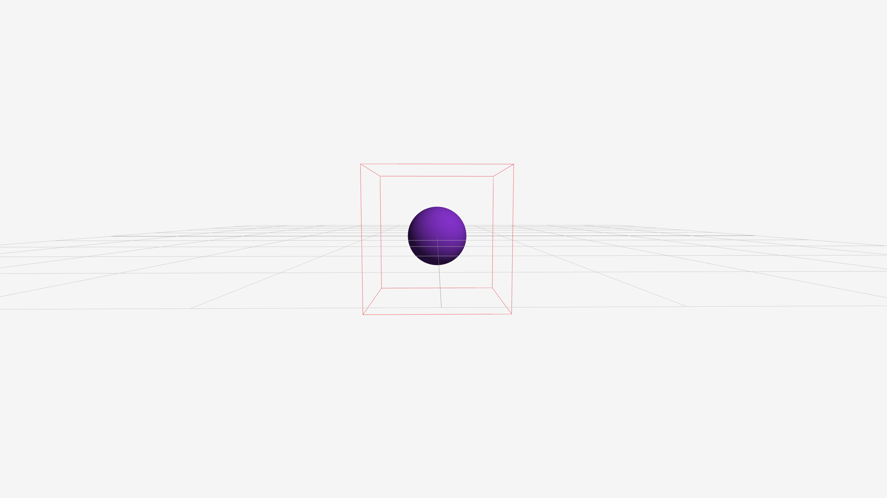|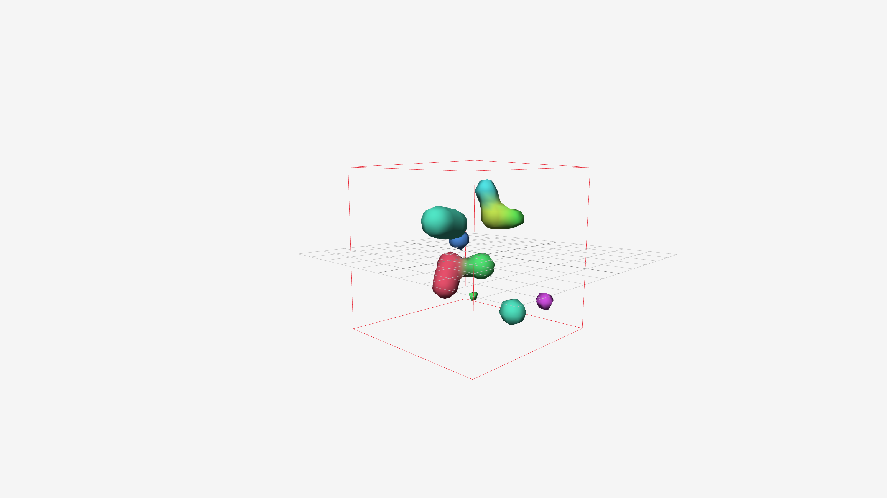|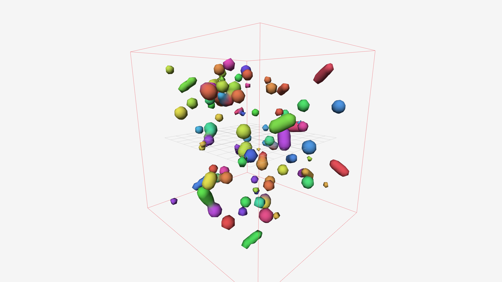|

### Comparaison
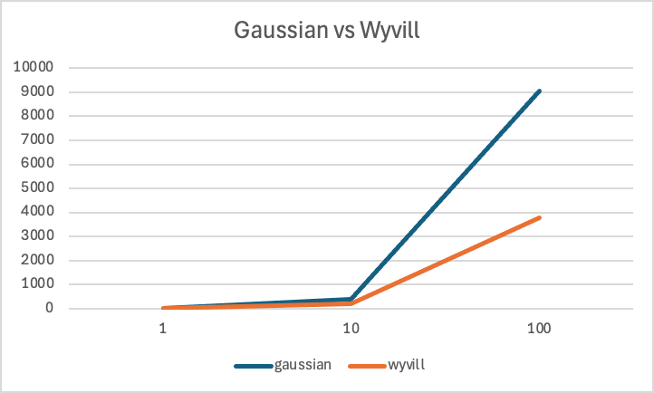
*Durée (ms) de l'éxecution de marching cube de Gaussian et Wyvill en fonction du nombre de primitives.*
Visuellement,les blobs gaussien sont plus gros (ils dépassent de leur rayon).
En termes de performances, les blobs de Wyvill ont une bien meilleure progression.

Pour la suite du TP, seuls les blobs de Wyvill ont été utilisés (notamment car ils permettent d'utiliser des BHV car ils sont compacts).

## Primitives
### Sphère
Passer la distance au carré à l'atténuation évite une racine carrée par évaluation.
```cpp
float  SphereBlob::Distance(const Vector& p){

    return SquaredNorm(p-center);
    
}
```

### Capsule
La capsule est définie comme la distance à un segment.

```cpp
float  CapsuleBlob::Distance(const Vector& p){
    Vector pa = p - a;
    Vector ba = b - a;
    float h = std::clamp( MoreVector::Dot(pa,ba)/MoreVector::Dot(ba,ba), 0.0f, 1.0f );
    return SquaredNorm( pa - ba*h );
}
```

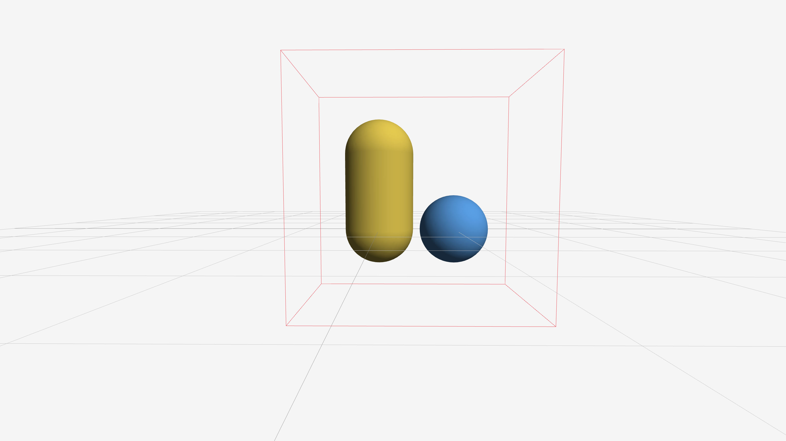
*Les primitives capsule et sphère*

## Borne de Lipshitz
Les deux types de primitives ont la même borne lipschitzienne car la distance à un segment est 1-lipschitzienne comme celle à un point, donc la capsule a la même borne que la sphère. Trois méthodes de calculs ont été implémentées.

### Par analyse
La première utilise la dérivée maximale de la formule de Wyvill, atteinte en `1/sqrt(2n-1)`. On peut alors la diviser par R pour obtenir la borne de lipschtiz de la sphère atténuée par Wyvill. Cette méthode permet d'avoir la borne la plus petite possible, mais elle exige de pouvoir dériver la fonction de potentiel.

```cpp
static const double x = 1/std::sqrt(2*WYVILL_N - 1);
static const double Kprim = 2 * WYVILL_N * x * pow((1 - x*x), (WYVILL_N-1));
this->lip_bound =  Kprim/potential;
```
x et Kprim ne sont calculés qu'une seule fois à l'execution.

### Par composition
On peut aussi prendre le facteur maximum de la dérivée, ici 2 de x^2.

### Par échantillonnage
On peut aussi estimer la borne en prenant un grand nombre d'échantillons de x, et en gardant la valeur max de la dérivée à ce point. On garde une marge de sécurité
1000 échantillons avec une marge de sécurité de 1 % retrouvent la borne analytique, ce qui la valide numériquement et montre que la méthode marcherait pour un noyau sans dérivée connue.
```cpp
double samp_x = 0;
    double step = 1/SAMPLING_N;
    double max_k = 0;   
    for (int i = 0; i<SAMPLING_N; i++){
        samp_x += step;
        double Kprimed = 2 * WYVILL_N * samp_x * pow((1 - samp_x*samp_x), (WYVILL_N-1));
        if(Kprimed > max_k){
            max_k = Kprimed;
        }   
    }
    this->lip_bound =  max_k*SAFETY_FACTOR/potential;
```

### Récap
|Méthode|Borne (R=1)|Ratio|Avantage|Inconvénient|
|-|-|-|-|-|
|Analyse|1.71730|1.00|Borne optimale|La fonction potentielle doit être dérivable|
|Composition|6.00000|3.49|Simple et peu couteux à calculer|Surestimation de la borne|
|Echantillonnage|1.73447|1.01|Fonctionne sur n'importe quelle fonction|Modèle probabiliste

## Arbre de Blob
Les blobs sont traités par une structure d'arbre. Lorque `Evaluate` est appelé sur la racine, le calcul est propagé récursivement en profondeur grâce à la fonction virtuelle de `Node`. Les enfants sont des `unique_ptr`pour éviter les fuites de mémoire.

`Node` a aussi une fonction virtuelle pour le calcul de la borne de Lipschitz, ce qui permet de pouvoir requêter sa valeur sur chaque noeud de l'abre (utile pour l'accélération).

## Opérations (binaires)
Pour chaque opérateur sont défini les fonctions d'évaluations et le calcul de la borne de lipschitz.
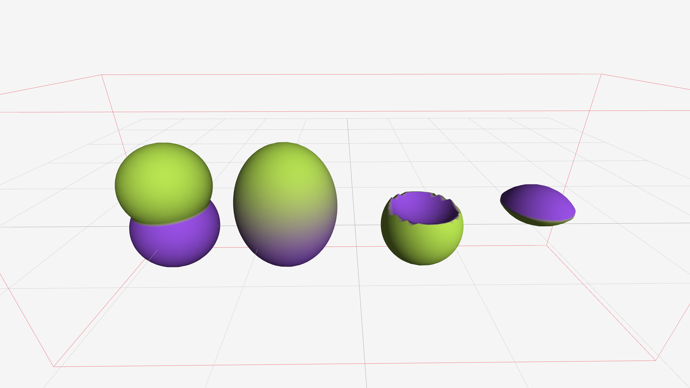
*Les quatres opérateurs binaires sur des sphères: union, blend, différence, intersection.*

## Couleurs
Les blobs ont aussi une couleur qui leur est propre. L'opérateur blend interpolarise les couleurs.
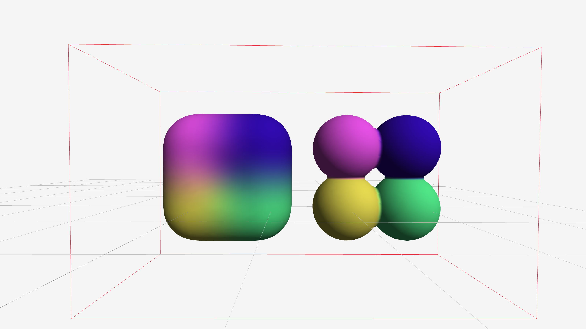
*Blend vs union de sphères colorées*


## Transformations (unaires)
En plus des opérateurs binaires, les transformations usuelles ont été implémentées. Elles aussi implémentent le calcul de la borne de lipschitz transformée.
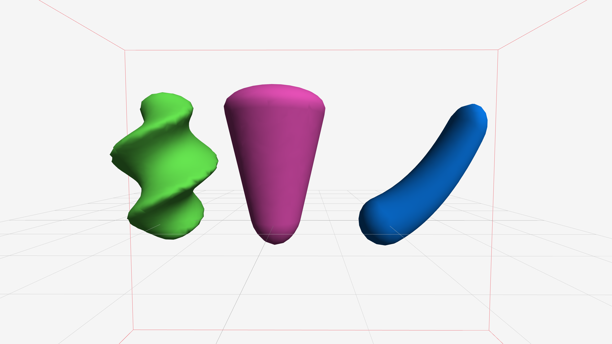
*Les trois transformation sur des primitives: twist sur sphère allongée en Z et en Y, taper sur une capsule, bend sur une capsule.*
### Translation
La translation ne change ni la borne de Lipschitz, ni la taille de la boîte, qui est simplement décalée.
### Scale
La borne est divisée par le facteur minimal de la scale.
### Rotate
La rotation ne change pas la borne, mais la boîte est tournée doit être réaligner, ce qui l'agrandit.
### Twist
La forme reste dans un cylindre vertical de rayon p, ce qui donne à la fois la boîte et la borne (1 + |rate|*p).
### Bend
Comme pour twist.
### Taper
La boîte prend les extrêmes des quatre produits avec le taux. La borne devient infinie si le produit est inférieur ou égal à 0. Cette estimation est plutôt large car elle prend en compte le scale aux points les plus extrêmes de la bounding box alors que le scale n'est pas appliqué uniformément partout.
### Révolution
La distance à l'axe Y est injectée dans la coordonnée X. 

# Accélération de requête (BHV)
## Equilibrage de l'arbre
Chaque suite d'un même opérateur commutatif et associatif (blend, union, intersection) est aplatie puis reconstruite en arbre équilibré groupé par plus proche voisin, ce qui passe d'une profondeur O(n) à O(log n) avec des petites sous-boites enboitées.

Déterminer le meilleur ordre pour regrouper les blobs les plus proches les uns des autres, est un problème NP complet. J'ai décidé d'utiliser l'heuristique des plus proches voisins (voyageur de commerce) pour simplifier l'implémentation. Il est connu pour donner en moyenne une solution qui est à 25% moins bien que la solution optimale.

La différence et les transformation ne sont pas commutatives donc elles ne sont pas réordonnée.

## Calcul de la bounding box
Comme pour `Eval` et `GetLipschitzBound`, la bounding box est calculée dans l'abre par récursivité sur une méthode virtuelle de `Node`. Pour la sphère, la boîte englobante est le cube de côté 2*rayon centré sur le centre.

Les bounding box sont calculées une fois pendant le tri, puis une fois équilibré, une autre fois. Elles sont stockées dans chaque noeud, donc leur coût (colonne `bbox`) est négligeable devant la polygonisation.

## Pruning
Pour comparer les performances avec et sans le pruning, une nouvelle fonction virtuelle `EvalPruned` a été ajoutée à `Node`. `EvalPruned` est ainsi redéfini dans tous les opérateurs binaires pour retourner automatique 0 si un des enfants ne pourra pas se trouver dans la bounding box du noeud. Comme dans l'opérateur différence :
```cpp
float DifferenceBlob::EvalPruned(const Vector& p){
    if(!left_child->GetBBox().isIn(p)){
        return 0.0f;
    }else if(!right_child->GetBBox().isIn(p)){
        return Math::Min(left_child->EvalIfIn(p), 2*AnalyticScalarField::threshold);
    }else{
        return Math::Min(left_child->EvalIfIn(p), right_child->EvalIfIn(p));
    }
    
}
```
Mais ce qui fait la plus grande différence, c'est que les noeuds terminaux appellent `EvalIfIn` de `Node` qui revoie directement 0 si le point est en dehors de la bounding box, épargnant un appel à la fonction potentiel.

C'est aussi rendu possible par la fonction de Wyill qui est à suport compact et dont tous les points sur la surface sont inclus dans la bouding box.


## Benchmark 
### Avec accélération
|primitive count|parse|bbox|polygonize|upload|total|triangles|evaluation|
|-|-|-|-|-|-|-|-|
|10|0.054 ms | 0.086 ms | 116.377 ms | 2.851 ms | 119.371 ms | 8236, 64^3 grid | 332416 (0.4 us each)|
|50|0.170 ms | 0.750 ms | 461.018 ms | 3.401 ms | 465.340 ms | 12000, 64^3 grid | 369736 (1.2 us each)|
|100|0.335 ms | 2.282 ms | 1573.221 ms | 6.563 ms | 1582.403 ms | 18048, 64^3 grid | 428372 (3.7 us each)|
|500|1.595 ms | 41.136 ms | 10977.045 ms | 8.901 ms | 11028.679 ms | 28376, 64^3 grid | 535952 (20.5 us each)
|1000|2.614 ms | 149.332 ms | 31353.544 ms | 12.328 ms | 31517.820 ms | 34968, 64^3 grid | 626936 (50.0 us each)|

### Sans accélération

|primitive count|parse|bbox|polygonize|upload|total|triangles|evaluation|
|-|-|-|-|-|-|-|-|
|10| 0.035 ms | 0.003 ms | 157.462 ms | 1.298 ms | 158.799 ms | 5960, 64^3 grid | 315252 (0.5 us each)|
|50|0.168 ms | 0.012 ms | 1414.243 ms | 3.155 ms | 1417.580 ms | 12920, 64^3 grid | 377284 (3.7 us each)|
|100|0.363 ms | 0.023 ms | 5203.705 ms | 4.595 ms | 5208.688 ms | 17776, 64^3 grid | 423260 (12.3 us each)|
|500| 1.557 ms | 0.158 ms | 139628.823 ms | 7.634 ms | 139638.175 ms | 29228, 64^3 grid | 543368 (257.0 us each)|
|1000|2.605 ms | 0.242 ms | 612141.327 ms |8.791 ms | 612152.967 ms | 34384 triangles, 64^3 grid | 621844  (984.4 us each)

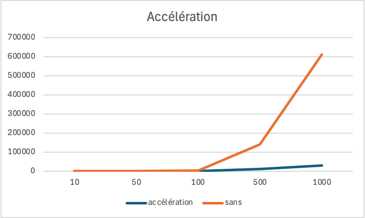

La progression du temps d'éxecution avec et sans accélération (BVH) est incomparable. D'un facteur ~20 sur 1000 primitives.

# Améliorations possibles
Utiliser la borne de lipschitz pour le marching cube (on a déjà la borne calculé à chaque noeud). Avec la borne L, un point où `|f − T| > L * d` est à plus de d de la surface, donc on pourrait sauter des cellules entières de la grille au lieu de toutes les évaluer, notamment celles qui ne sont pas pruned par le BVH.